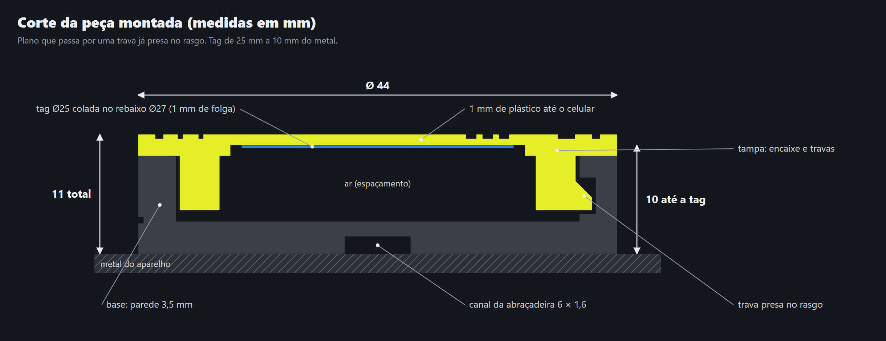

# Porta-tag NFC + QR code em forma de anilha (protótipo)

Peça de duas partes. A tag NFC adesiva de **25 mm** fica a **10 mm do metal** do aparelho, e a tampa leva um
**QR code** para quem não conseguir usar o NFC. Os dois abrem o mesmo vídeo.
A **base** fica presa no aparelho; a **tampa** guarda a tag e fecha com **quarto de volta**.



## Arquivos

| Arquivo | Para quê |
|---|---|
| `tag-anilha-base.stl` | base (igual para todos os aparelhos; já na posição: fundo na mesa) |
| `tampas/tampa-A01.stl` … `A08` | uma tampa por aparelho, cada uma com o QR do seu link (já virada: face na mesa) |
| `tampas/links.csv` | o que gravar em cada tag NFC e qual tampa vai em qual aparelho |
| `tampas/face-A01.png` … | a face de cada tampa, usada para conferir que o QR lê |
| `tag-anilha.scad` | o desenho editável no [OpenSCAD](https://openscad.org) (grátis) |
| `desenho-corte.png` | corte com as medidas |

## Medidas principais

- Diâmetro 44 mm, altura total 11 mm (base 9 + tampa 2).
- Tag Ø25 num rebaixo Ø27 × 1 mm de fundo (1 mm de folga de cada lado: entra sem forçar), com 1 mm de plástico até o celular (0,6 mm onde tem o QR).
- QR de 19 × 19 mm (25 × 25 quadrados de 0,76 mm), com margem clara em volta.
- Encaixe: 3 travas, gira 35° no sentido horário para travar, folga de 0,3 mm.
- Canal de 6 × 1,6 mm embaixo da base para abraçadeira ou velcro (aparelho de tubo).
- Furo lateral para parafuso **M2 × 6 mm autoatarraxante** (opcional).
- Código do aparelho (A01, A02…) gravado por baixo da borda da tampa.

## Impressão

- **Material:** PETG. Para o preto, use PETG ou PLA **comum**, nunca com carbono ou metal: isso bloqueia o NFC.
- **Camada 0,2 mm**, 3 paredes, preenchimento de 20 a 30%, **sem suporte**.
- **Tampa em duas cores (troca de filamento):**
  1. Comece com a cor clara (amarelo ou branco).
  2. No fatiador, coloque **troca de filamento na altura 0,4 mm** (início da 3ª camada).
     No Cura: *Extensões → Pós-processamento → Filament Change*; no PrusaSlicer/Bambu/Orca: clique com o direito na camada e escolha *Trocar cor*.
  3. Quando a impressora pausar, troque para o **preto** e continue.
  4. Vista de cima, a tampa fica clara com o QR, os textos e o sulco em preto.
- A base imprime numa cor só (sugestão: grafite ou preto).

## Montagem

1. Abra `tampas/links.csv`: cada linha diz o aparelho, a tampa e o link da tag.
2. Grave o link da coluna **gravar_na_tag_nfc** (ex.: `HTTP://.../N/A01`) na tag com o app **NFC Tools**, teste e **trave a tag** (só leitura).
3. Cole a tag no rebaixo da tampa certa (o código está por baixo da borda), com o adesivo no "teto" do rebaixo.
4. Prenda a base no aparelho: fita 3M VHB (superfície lisa) ou abraçadeira pelo canal (tubo).
5. Alinhe o recorte da tampa com o risco da base, encaixe e gire no sentido horário até parar.
6. Teste os dois: encoste o celular e aponte a câmera para o QR.

## Links

- Os links apontam para **`https://toquefit-zyrek.pages.dev`**, o endereço grátis da demonstração na Cloudflare Pages (o projeto precisa ser publicado com o nome `toquefit-zyrek`).
- Quando houver o endereço definitivo, gere as tampas de novo com ele (de preferência um domínio curto):

```
python ferramentas/gerar_tampas.py HTTPS://SEU-DOMINIO.COM
```

- O QR leva para `/Q/A01` e a tag para `/N/A01`. A demonstração abre o aparelho certo e o painel mostra quantos toques vieram de cada um.

## Ajustar o desenho

Abra `tag-anilha.scad` no OpenSCAD, em **Janela → Customizer**:

- `academia`: nome na borda de baixo. `instrucao`: frase de cima. `marca`: texto da lateral da base.
- `afast`: distância da tag até o metal (padrão 10). `tag_d`: diâmetro da tag.
- `folga`: encaixe duro, use 0,4; frouxo, 0,25.

## Teste antes de imprimir o lote

Imprima **1 conjunto**, monte no aparelho real e teste com 2 ou 3 celulares, incluindo um iPhone:
o NFC encostando e o QR com a câmera. Se o NFC falhar, aumente `afast` para 12. Se o QR demorar a ler,
confira se a troca de filamento ficou exatamente em 0,4 mm.
